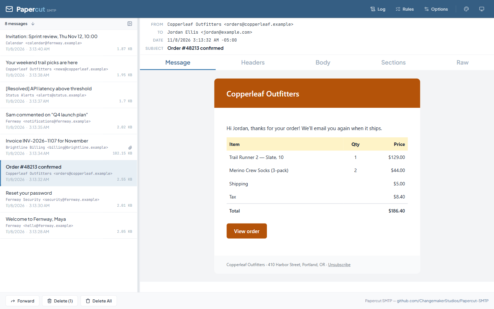

# Desktop App

The Papercut SMTP desktop app is both the SMTP server and the viewer — when it's running, you're catching email. It runs on Windows and macOS. It sits in the system tray (the menu bar on macOS), and its window shows the same web UI as the [service](service.md).

## The Tray

The tray icon shows Papercut's status and opens its menu:

- **Open Papercut** — opens the window
- **Open in Browser** — opens the same UI in your default browser
- **Run at Startup** and **Show Notifications**
- **View Logs** — opens the log folder
- **Exit** — stops Papercut, and with it the SMTP server

Closing the window keeps Papercut running in the tray. Use **Exit** to stop it.

New mail triggers a notification. On Windows, clicking it opens the message.

## Message Views

Select a message to inspect every layer of it:

- **Message** — the rendered HTML, exactly as an email client would show it (embedded images included)
- **Headers** — the full header list
- **Body** — the plain-text body
- **Sections** — every MIME part, viewable and downloadable individually (attachments included)
- **Raw** — the raw encoded message source

## Managing Messages

- Messages are stored as standard **`.eml` files** — **File → Open Data Folder** in the window takes you to them
- **Delete** removes the selected message(s); **Delete All** clears them all after you confirm
- **Forward** a received message on to a real SMTP server (with optional authentication) when you need to get a captured email out

## Rules

Papercut can act on messages automatically as they arrive:

- **Forward** — pass received messages along to another SMTP server (supports authentication)
- **Relay** — conditionally relay matching messages
- **Retention** — periodically prune old messages

Configure rules with the **Rules** button in the web UI.

## Options

The **Options** dialog in the web UI has:

| Setting | Default | Notes |
|---------|---------|-------|
| SMTP IP | `Any` | Accepts mail from other machines. Pick `127.0.0.1` to accept mail from this machine only |
| SMTP Port | `25` (`2525` on macOS) | Any free port works |
| Sort Order | Newest first | |
| Theme | System | Light / Dark / follow the system, with accent colors beside it |
| MCP | Off | See [MCP Server](mcp.md) |

**Run at Startup** and **Show Notifications** are in the window's **Options** menu.

To change where messages are stored, edit `MessagePaths` in `Papercut.Shell.json` in the data folder, then restart Papercut.

## Using a Service You Already Run

If the [Windows Service](service.md) or a [Docker container](docker.md) is already running on your machine, the desktop app uses it instead of starting its own. Options and rules then apply to that service, and mail goes to its SMTP port, which defaults to `2525`. The tray's status line shows which one is in use, and for an installed Windows Service the menu can start and stop it.

## Logs

**View Logs** in the tray menu opens the log folder, and the web UI has a live log viewer. Logs show SMTP server start and stop, received messages, and any errors. They're the first place to look when something seems off (see [Troubleshooting](troubleshooting.md)).
