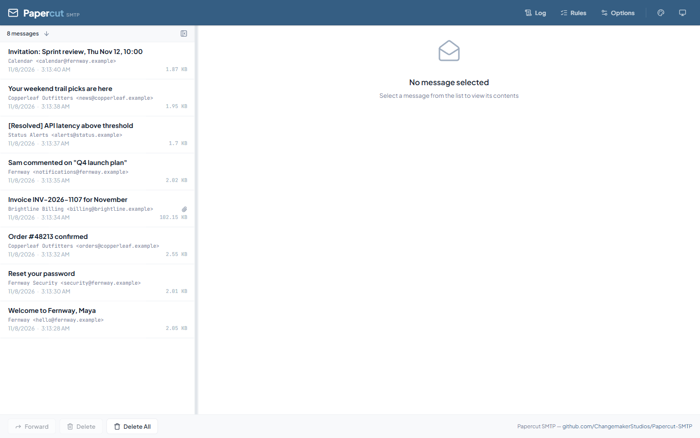
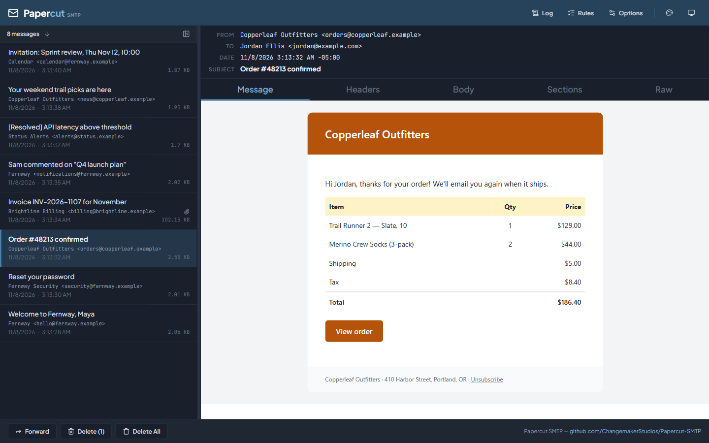

# Service & Web UI

The **Papercut SMTP Service** is an optional background component that receives email even when the desktop app isn't running — as a Windows Service or a [Docker container](docker.md) — and includes a browser-based UI for viewing messages.

!!! note "The service is optional"
    For normal desktop use, the Papercut app alone is a complete SMTP server and viewer. Install the service for always-on setups, shared dev servers, or headless environments.

## Web UI

The service serves a web interface at **http://localhost:8080** by default. The [desktop app](desktop.md) shows the same UI in its window:





## Install as a Windows Service

1. Download `Papercut.Smtp.Service.*.zip` (x64, x86, or ARM64) from the [latest release](https://github.com/ChangemakerStudios/Papercut-SMTP/releases/latest)
2. Extract it anywhere
3. Run the install script **as administrator**:
   - `install-papercut-service.bat` (double-click), or
   - `.\install-papercut-service.ps1` (PowerShell)

The service installs with automatic startup and starts immediately. To uninstall, run `uninstall-papercut-service.bat` / `.ps1`.

You can also run it as a plain console app — just execute `Papercut.Service.exe`.

## Configuration

The service needs no manual configuration: change its settings under **Options** and its rules under **Rules** in the web UI. If the desktop app runs on the same machine, it uses a running service instead of starting its own, so those settings and rules apply there too.

For manual configuration, the service uses layered files (highest priority first):

| File | Purpose |
|------|---------|
| `Papercut.SMTP.Service.Settings.json` | User settings — UI changes are saved here (SMTP `IP`, `Port`, etc.) |
| `rules.json` | Persisted rules |
| `appsettings.Production.json` | Docker/production overrides (non-privileged ports) |
| `appsettings.json` | Baseline defaults (SMTP port 2525, IP Any) |

Restart the service after manual edits.

### Common changes

**SMTP port** — `Papercut.SMTP.Service.Settings.json`:

```json
{ "Port": "2525" }
```

**Web UI binding** — `appsettings.json` `Urls` setting:

```json
{ "Urls": "http://localhost:8080" }
```

Use `http://0.0.0.0:8080` to listen on all interfaces — but read the warning below.

**Path prefix** (reverse proxy / ingress) — serve the web UI under e.g. `/webmail`:

```json
{ "HttpPathPrefix": "/webmail" }
```

!!! warning "Network exposure"
    When binding to `0.0.0.0`, `+`, `*`, or a LAN IP, the web UI is reachable from other machines — and Papercut has **no built-in authentication**. Use firewall rules or a reverse proxy with auth in front of it.

**Rate limiting** — reject mail once a quota is hit, so you can test how your application
handles a mail server that is throttling it (`appsettings.json`):

```json
{
  "SmtpServer": {
    "RateLimit": "500/1h",
    "RateLimitReplyCode": 451
  }
}
```

`RateLimit` is `<count>/<window>`, where the window is a number followed by `s`, `m`, or `h` —
for example `500/1h`, `5/10m`, or `100/30s`. Use `*` (the default) for no limit.

Once the limit is reached, Papercut rejects at `MAIL FROM` until the window resets:

```text
451 4.7.1 Message rate limit exceeded (500 per hour)
```

`RateLimitReplyCode` accepts any 4xx or 5xx reply code — 421, 451 (the default), 452 and 550
are the usual choices. A 4xx code tells the sending client the failure is temporary and worth
retrying; a 5xx code tells it the message was permanently refused.

The count is global to the server rather than per-sender or per-IP, and the window is fixed:
it starts when the first message arrives and resets in full once it expires.

Environment variable form (Docker): `SmtpServer__RateLimit` and `SmtpServer__RateLimitReplyCode`.

## API

The web UI is backed by a small HTTP API (`/api/messages`, etc.) you can script against — handy for asserting "an email was sent" in end-to-end tests. Explore the endpoints via your browser's dev tools on the web UI.

### Creating a message

You can put a message straight into Papercut without SMTP, which makes it a handy local notification system: it shows up in the inbox and raises a desktop notification like received mail, and rules run on it.

```bash
curl -X POST http://localhost:8080/api/messages   -H "Content-Type: application/json"   -d '{"subject": "Deploy finished", "from": "CI <ci@example.com>", "markdown": "# All green

- **api** deployed
- **web** deployed"}'
```

`PUT` works the same way. It returns `201` with the new message's summary, including its `id`.

| Field | |
|---|---|
| `subject` | Subject, and the notification text |
| `markdown` | Body, rendered to HTML (tables and the other common extensions work); the source becomes the plain text part |
| `html` | Body as HTML. Use this or `markdown`, not both |
| `text` | Plain text body |
| `from` | One address. Defaults to `Papercut <papercut@localhost>` |
| `to`, `cc` | Comma-separated addresses, optional |
| `notify` | Raise a notification. Defaults to `true`; with `false` the message still appears in the inbox |

A subject alone is enough.

### Calling the API from a web page

Scripts, curl and MCP clients aren't affected by this. Web pages are: a page on another origin gets `403` from the API, MCP and the live-update hub, which stops ordinary cross-site requests from a site you visit reading or deleting your captured mail. The web UI is same-origin, including behind a reverse proxy that keeps `Host` or sets `X-Forwarded-Host`. A proxy that does neither gets a blank page. nginx does neither by default, so add `proxy_set_header Host $http_host;`.

To let your own page call Papercut, or if a proxy rewrites `Host` without setting `X-Forwarded-Host`, list the origins in `CorsAllowedOrigins`, separated by `;` (`Papercut.SMTP.Service.Settings.json`, `appsettings.json`, or the environment variable), then restart:

```json
{ "CorsAllowedOrigins": "http://localhost:3000;https://tools.example.com" }
```

`*` allows any origin, which also lets any website you visit reach your mail. Avoid it outside a locked-down environment.

For AI agents and coding assistants, the service can also expose these operations over the Model Context Protocol — see [MCP Server](mcp.md).
